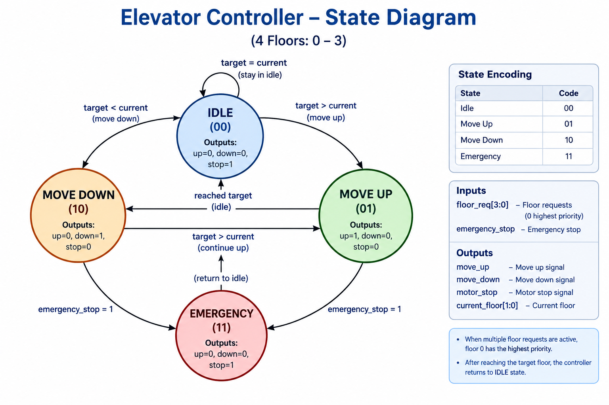
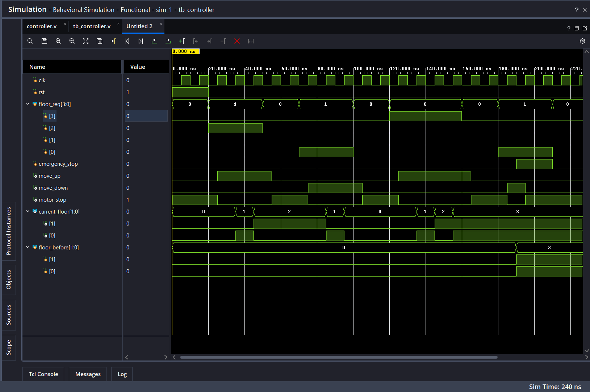
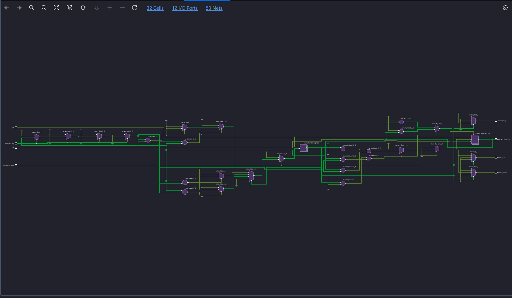

# Elevator Controller Using Verilog HDL

A four-floor elevator controller designed using Verilog HDL and a Finite State Machine (FSM). The project demonstrates floor selection, upward and downward movement, motor control, and emergency stop operation.

## Project Overview

The elevator controller manages requests for four floors: Floor 0, Floor 1, Floor 2, and Floor 3.

It compares the requested floor with the current floor and determines whether the elevator should move up, move down, or remain stopped. An emergency stop input is also provided to stop elevator movement.

The design is verified using a Verilog testbench and simulated using a digital design simulation tool. Vivado is used to examine the design schematic.

## Features

- Four-floor elevator control system.
- FSM-based control logic.
- Automatic direction selection based on the requested floor.
- Separate signals for upward and downward movement.
- Motor stop control.
- Emergency stop functionality.
- Verilog testbench for functional verification.
- Simulation waveform analysis.
- Vivado RTL and synthesized schematic visualization.

## State Diagram

The controller uses four states:

- **IDLE:** The elevator remains stopped.
- **MOVE UP:** The elevator moves toward a higher floor.
- **MOVE DOWN:** The elevator moves toward a lower floor.
- **EMERGENCY:** The elevator stops when an emergency is detected.



## FSM State Encoding

| State | Encoding |
|---|---|
| IDLE | `00` |
| MOVE UP | `01` |
| MOVE DOWN | `10` |
| EMERGENCY | `11` |

## Inputs and Outputs

### Inputs

| Signal | Width | Description |
|---|---|---|
| `clk` | 1 bit | Clock signal |
| `rst` | 1 bit | Active-high asynchronous reset |
| `floor_req` | 4 bits | Floor request inputs for Floors 0–3 |
| `emergency_stop` | 1 bit | Emergency stop input |

### Outputs

| Signal | Width | Description |
|---|---|---|
| `move_up` | 1 bit | Indicates upward movement |
| `move_down` | 1 bit | Indicates downward movement |
| `motor_stop` | 1 bit | Indicates that the motor should stop |
| `current_floor` | 2 bits | Indicates the current floor (0–3) |

## Working Principle

1. The controller starts at Floor 0 after reset.
2. The requested floor is selected using the `floor_req` input.
3. If the target floor is higher than the current floor, the FSM enters MOVE UP.
4. If the target floor is lower than the current floor, the FSM enters MOVE DOWN.
5. When the target floor is reached, the controller returns to IDLE.
6. When `emergency_stop` is asserted, the FSM enters EMERGENCY and the motor stop signal is activated.
7. When the emergency signal is cleared, the controller returns to IDLE.

**Floor request priority:** If multiple floor request bits are asserted simultaneously, the current design selects the lowest-numbered active floor first.

## Simulation Results

The Verilog testbench is used to examine the controller's behavior under different operating conditions.

### Simulation Waveform

The waveform displays the clock, reset, floor requests, current floor, movement signals, and emergency stop signal.



### Test Cases

| Test | Operation | Expected Result |
|---|---|---|
| Test 1 | Request Floor 2 | Elevator reaches Floor 2 |
| Test 2 | Request Floor 0 | Elevator reaches Floor 0 |
| Test 3 | Request Floor 3 | Elevator reaches Floor 3 |
| Test 4 | Activate emergency stop while moving down | Motor stops and the current floor remains unchanged during the checked interval |

The testbench prints the test results in the simulator console.

**Note:** These tests should be considered successful only after the simulation output and waveform have been checked.

## Vivado Implementation

### Implementation Schematic

The following image shows the schematic generated in Vivado for the elevator controller.



The schematic helps visualize the logic structure inferred from the Verilog design.

**Schematic type:** Specify whether the image is an RTL schematic, synthesized schematic, or implemented schematic.

## Project Files

| File | Description |
|---|---|
| `controller.v` | Main Verilog module |
| `tb_controller.v` | Verilog testbench |
| `state_diagram.png` | FSM state diagram |
| `simulation_result.png` | Simulation waveform screenshot |
| `implementation_diagram.png` | Vivado schematic screenshot |
| `README.md` | Project documentation |

## How to Run the Simulation

### Using Icarus Verilog

Make sure Icarus Verilog is installed and both Verilog files are in the same directory.

**Step 1: Compile the design and testbench**

```bash
iverilog -o elevator_sim controller.v tb_controller.v
```

**Step 2: Run the simulation**

```bash
vvp elevator_sim
```

The testbench output will appear in the terminal.

### Using Vivado

1. Create a new RTL project.
2. Add `controller.v` as a design source.
3. Add `tcontroller.v` as a simulation source.
4. Set `tb_controller` as the simulation top module.
5. Run behavioral simulation.
6. Inspect the signals in the waveform viewer.
7. To inspect the RTL schematic, open the elaborated design.
8. To inspect the synthesized schematic, run synthesis and open the synthesized design.

The testbench is for simulation and is not part of the synthesizable hardware design.

## Tools and Technologies

- **HDL:** Verilog
- **Design Concept:** Finite State Machine (FSM)
- **Simulation:** Vivado Simulator / Icarus Verilog
- **Schematic Analysis:** AMD Xilinx Vivado
- **Version Control:** Git and GitHub

## Future Improvements

- Support for additional floors.
- Improved scheduling for multiple simultaneous requests.
- Door opening and closing control.
- Floor arrival indicators.
- Improved emergency handling and verification.
- FPGA board testing with suitable hardware interfaces.

## Applications

- Digital logic design practice.
- FSM design and verification.
- RTL simulation and schematic analysis.
- Learning Verilog HDL and FPGA design workflows.

## Disclaimer

This project is intended for educational purposes and simulation practice. It is not designed or safety-certified for use in a real elevator system.


